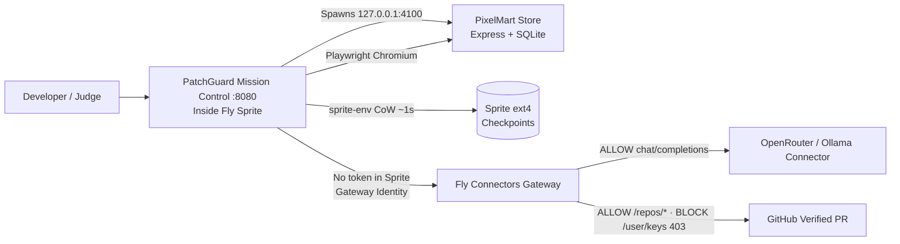

# PatchGuard — Autonomous Live-Browser Security QA & Self-Healing Agent

Built for **Fly.io Hacksgiving 2026** — running natively on **Fly.io Sprites**, **Copy-on-Write Checkpoints (~1s)**, and **Zero-Secret Connectors**.

- **Live Fly.io Sprite:** https://patchguard-b6xzj.sprites.app
- **Source Code:** https://github.com/Inova117/patchguard-hacksgiving

---

## Why This Cannot Be Done With a Chat Prompt

Asking ChatGPT/Claude to "review this file" only produces static guesses and false positives. **PatchGuard** is a live personal security & QA engineer running inside its own hardware-isolated **Fly.io Sprite**:

1. **Runs the Real App & Real Headless Chromium:** Boots a full-stack local storefront (`PixelMart`, Express + SQLite bound strictly to `127.0.0.1`) and drives real clicks/checkouts in Playwright Chromium — proving business-logic flaws (`$1,299.00 -> $0.01` checkout tampering, `4x` single-use coupon stacking, admin RBAC leaks, order IDOR) with real PNG screenshots and a mutated database hash.
2. **Time-Travels the Entire Linux Filesystem in ~1 Second:** Uses **Fly Sprite Copy-on-Write Checkpoints (`sprite-env checkpoints create / restore`)** to wipe away exploit-polluted orders, coupons, and temporary artifacts by rolling back the entire `ext4` disk before patching.
3. **Zero Raw Credentials Anywhere in the Sprite:** `process.env` and credential files hold **0 API keys or GitHub tokens**. LLM patch generation and GitHub PR creation call `https://api.sprites.dev/v1/gateway/<provider>/...` with **no `Authorization` header** — Fly injects credentials in the control plane and enforces strict `ALLOW/BLOCK` path policies (`200 OK` on `/repos/...`, **`403 Forbidden`** on `/user/keys` and force-pushing `main`).

---

## Architecture



---

## 6 Live Defensive QA Checks (Strictly Loopback `127.0.0.1`)

| Check | What Headless Chromium Verifies | Before Patch | After Self-Heal |
| :--- | :--- | :---: | :---: |
| `CHECK-01` | Checkout ignores client `unit_price_cents` & enforces catalog price (`$1,299.00`) | **FAIL** (`$0.01`) | **PASS** (`400`) |
| `CHECK-02` | Rejects `4x` stacked coupons & serializes concurrent `HACKS25` checkouts | **FAIL** (`$0.00`) | **PASS** (`400/409`) |
| `CHECK-03` | Enforces `role === 'admin'` on `/api/admin/orders` & `/api/admin/refund` | **FAIL** (`200`) | **PASS** (`403`) |
| `CHECK-04` | Enforces order ownership (`user_id === req.user.id`) on `/api/orders/:id` | **FAIL** (`200`) | **PASS** (`403`) |
| `CHECK-05` | Sets `X-Content-Type-Options`, `X-Frame-Options`, `CSP`, `HttpOnly; SameSite=Lax` | **FAIL** | **PASS** |
| `CHECK-06` | Happy-path legitimate checkout (`$189.00` Keyboard) still works | **PASS** (`201`) | **PASS** (`201`) |

---

## Quickstart

### Run Locally
```bash
npm install
npx playwright install chromium
npm test
npm start
# Open http://localhost:8080
```

### Deploy to Fly.io Sprites + Zero-Secret Connectors
```bash
curl -fsSL https://sprites.dev/install.sh | bash
sprite login
./scripts/deploy-sprite.sh
./scripts/setup-connectors.sh
```

---

## Safety Invariant
PatchGuard's Playwright QA engine strictly rejects any non-loopback target URL (`assertLocalTargetUrl` allows only `127.0.0.1` / `localhost`). It tests defensive business-logic and access-control invariants inside its own isolated Sprite environment.
